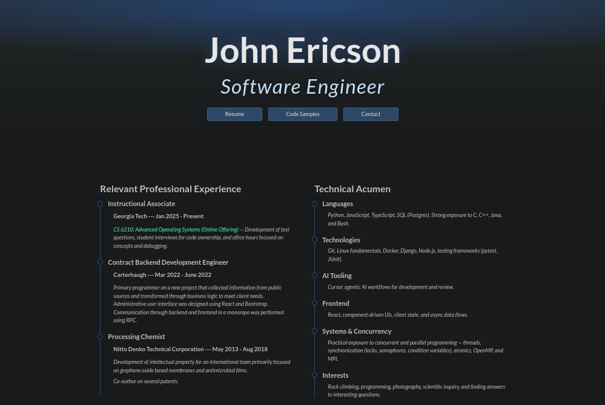
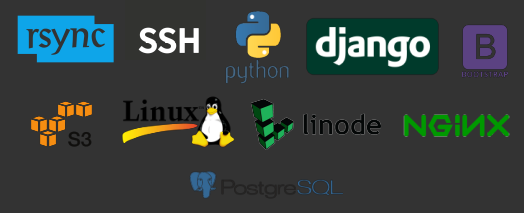
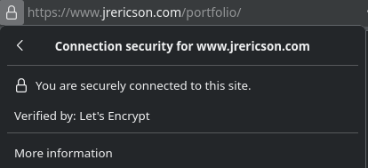
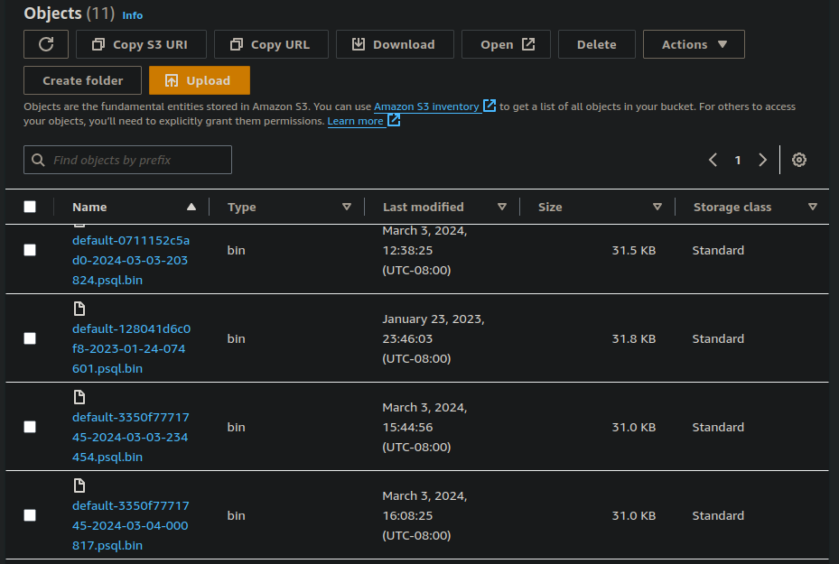
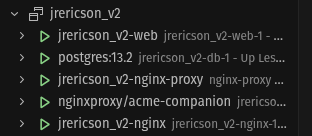
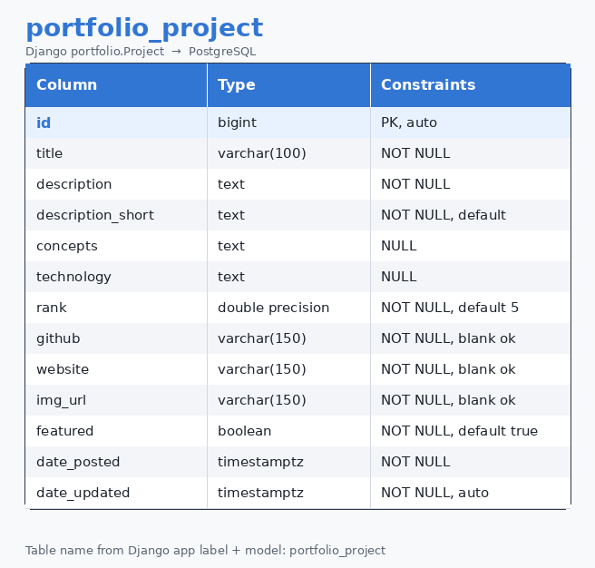
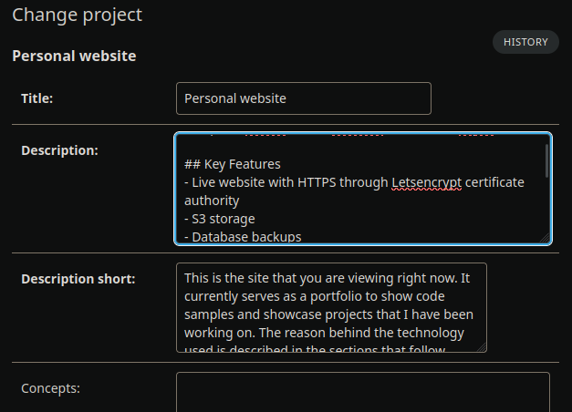
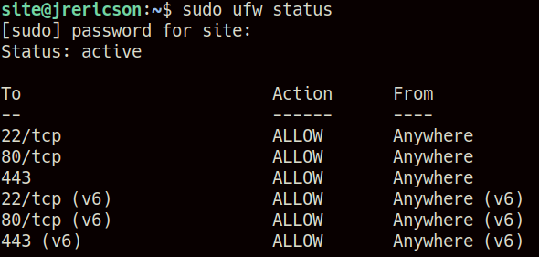

# jrericson_v2_rebuild
### [https://jrericson.com](https://jrericson.com)

## Project summary
This site is a portfolio for code samples and projects I’ve worked on. The technology choices are explained in the sections below.

### Project year
- **2024** 

### Project goals

**Primary goal** — Create a functional portfolio following good coding practices.

**Secondary goal** — Gain more experience with the technology used (Django, Docker, Linode, PostgreSQL, etc.).

## Technology
Python, Django, Markdown, Nginx, Docker, Docker Compose, Linode, Bash, Bootstrap, Linux, SSH, Rsync.

 

## Key Features
- **HTTPS** through Let's Encrypt certificate authority
  

- **S3 storage** for database backups
  
- Deployment on a remote Linux server
- Docker container-based deployment and development

- Email-based contact form re-routing to my in box (deprecated)
  - No longer implemented

### AI usage
Most of this code was written before I introduced agentic AI into my coding practices.
I have used AI in later versions, primarily for styling.
  
## Site structure

### Projects Model

Projects are stored with a variety of attributes, such as ranking (used for ordering), a GitHub link, a sample image, and a description of the project.

Project descriptions are written in Markdown.
- Converted to HTML using the `markdownify` library
- Convenience
    - Easy to write
    - Easy to transfer info from READMEs in GitHub repos
- New projects are added through the admin console

Projects are displayed and paginated through a Django `ListView`. Project descriptions are displayed using a Django `DetailView`.

## Security

- **Firewall**: Using UFW to further restrict access to the site.
  
- **SSH key**: Access to the host is restricted through an SSH key. Password and root access are disabled.
- **One-way access to S3 buckets** — The system is only able to write to S3 buckets, ensuring that no data can be overwritten.
- **CORS**: For trusted origins in Django.
- **Hidden access points**: The Admin portal is accessed via a hidden location.
- **HTTPS**: Using Let's Encrypt certificate authority.

- **Other standard practices:** Including sanitization, `.env` files, and `.gitignore` files.

## Backups
- Done with a manual checkpointing method
  - Uses `django-dbbackup`, which provides a wrapper over Postgres's `pg_dump`.
  - All backups are stored externally in an S3 bucket as described below.
  - A previous version of the site used **cron jobs** to do this

- Design decision
  - Backups could be done with a managed database
  - Implemented this way for zero financial cost and simplicity

## S3 storage
- Used as blob storage for backups
- Chosen due to familiarity

## Database: PostgreSQL

- Why PostgreSQL:
  - Cheap, easy, and familiar
  - Wanted SQL

## UI
- Bootstrap was chosen for simplicity.
- Uses the "Darkly" theme from Bootswatch to make the site less like generic Bootstrap.
- Dark by default.

## Site hosting

- Ubuntu server (LTS) using Linode: I am familiar with Debian distributions.
- Single node
- Remote access:
  - SSH
  - "Visual Studio Code Remote - SSH" extension
  - Rsync (or SCP) for file transfers

## Docker and Docker Compose
Docker has been chosen to run the site for the following reasons.

1. It simplifies porting from development to production.
2. It makes it easier to run the Nginx server, the database, the certificate authority, and other services with one another.

Separate Docker/Docker Compose files are provided for the production and local development environments.

## Nginx Web Server
Nginx is used to serve static content and act as a reverse proxy for the site.

## Email Form
- I previously had `send_mail()` send emails to my primary address. However, Google is discontinuing password-based logins.
- I rerouted to LinkedIn, as that is how most people will contact me.

## Git Usage

I use branching similar to the [Git Flow](https://www.atlassian.com/git/tutorials/comparing-workflows/gitflow-workflow#:~:text=What%20is%20Gitflow%3F,by%20Vincent%20Driessen%20at%20nvie.) method. There is a production branch and a development branch for features that get merged into it.

## Simplifying development

An `aliases.sh` Bash script is loaded to create shortcuts for common project-specific commands that I do not want to include in my personal `.bash_aliases` file.
- I have moved to Makefiles in more recent projects

## Citations for the codebase
The structure and design choices for the site were heavily based on the following sources. Much of the code from those tutorials was used as boilerplate.

- https://testdriven.io/blog/dockerizing-django-with-postgres-gunicorn-and-nginx/
- https://testdriven.io/blog/storing-django-static-and-media-files-on-amazon-s3/

